# Epson Wireless Projector — Protocol Specification

This is the reverse-engineered wire protocol used by Epson's *iProjection*
wireless projector line, as implemented by the reusable library in
[`lib/`](../lib/) (`lib/client/`, `lib/simulator/`, `lib/shared/` — see
[`main.ts`](../main.ts) at the repo root for example usage of both sides).
See [Provenance](#provenance) for where it comes from, and
[`reverse-engineering-todo.md`](./reverse-engineering-todo.md) for
everything that's still not understood.

Everything documented here has one of two confidence levels, stated
explicitly wherever it matters:

- **Verified** — confirmed against raw packet captures (`captures/*.pcapng`)
  byte-for-byte, and/or exercised end-to-end by the working library in
  `lib/`.
- **Inferred** — the structure is consistent across multiple captured
  payloads, but the *meaning* of specific fields is a best guess. Called out
  explicitly so nobody mistakes a guess for a fact.

## Documents

| Document | Covers |
|---|---|
| [`eemp-control-protocol.md`](./eemp-control-protocol.md) | `EEMP0100` — discovery, connection setup, session control. TCP/UDP port 3620. |
| [`eprd-video-protocol.md`](./eprd-video-protocol.md) | `EPRD0600` — the video/framebuffer stream. TCP port 3621. |
| [`reverse-engineering-todo.md`](./reverse-engineering-todo.md) | What's still unknown, with what the captures already show for each item. |
| [`second-projector-samples.md`](./second-projector-samples.md) | Two discovery replies from a second projector model, not in any capture. Useful for spotting per-device fields. |

## Big picture

Two independent binary protocols run over three ports (values below are
`lib/shared/ports.ts`'s defaults — they're plain TCP/UDP port numbers, not
something the projector negotiates; `lib/client` and `lib/simulator` both
accept overrides, and the example `main.ts` wires them from `.env` /
`config.ts`):

| Port | Transport | Protocol | Purpose |
|---|---|---|---|
| 3620 | UDP | `EEMP0100` | Discovery: client broadcasts, projectors reply with identity |
| 3620 | TCP | `EEMP0100` | Pre-connect probe, then the full session control channel |
| 3621 | TCP | `EPRD0600` | Video stream, client → projector only. The app opens **two** connections here; only the first ever carries data (the second is probably reserved for audio). |
| 3630 | HTTP | — | *Not part of the wire protocol.* Debug-only preview server in `lib/simulator/preview.ts`, serves a live canvas view of decoded frames over SSE. |

Both wire protocols share one 20-byte frame header (see
[`eemp-control-protocol.md § Wire Frame Header`](./eemp-control-protocol.md#wire-frame-header))
— only the 8-byte control word at the front differs (`EEMP0100` vs
`EPRD0600`), and the video protocol reuses it with one important
byte-order twist (see the video doc).

## Session lifecycle

```mermaid
sequenceDiagram
    participant C as Client (app)
    participant P as Projector

    rect rgb(30, 41, 59)
    note over C,P: Discovery — UDP, every message sent twice, replies go to app's port 3620
    C->>P: broadcast: status 1 (search)
    P-->>C: [0x1a if in use] + status 3 (identity, 74 B idle / 176 B in use)
    P-->>C: status 0x15 (capabilities)
    end

    rect rgb(30, 41, 59)
    note over C,P: Probe — TCP 3620, connect/close, repeated while the app is open
    C->>P: status 2 (probe)
    P-->>C: [0x1a] + status 3 + status 0x15
    end

    rect rgb(30, 41, 59)
    note over C,P: Session — TCP 3620, stays open
    C->>P: 0x01/1 connect request
    P-->>C: 0x02/1 accept
    P-->>C: 0x0e/1 state broadcast ×2 (+ 0x17 if reconnecting)
    C->>P: 0x08/1 layout request ("put me on screen")
    P-->>C: 0x09/1 layout accepted
    P-->>C: 0x0e/1 state broadcast
    P-->>C: 0x10/1 open video channel
    C->>P: (opens two TCP 3621 connections)
    P-->>C: 0x16/0 start streaming
    C->>P: 0x27/1 streaming started (optional)
    par each side, independently, every ~15 s
        C->>P: 0x0a heartbeat (empty)
    and
        P-->>C: 0x0a heartbeat (48 B, 44100)
    end
    end

    rect rgb(30, 41, 59)
    note over C,P: Video — first TCP 3621 connection
    C->>P: EPRD0600 hello (framebuffer size + pixel format)
    loop whenever the screen changes
        C->>P: FramebufferUpdate: 4 fixed JPEG tiles
    end
    end

    rect rgb(30, 41, 59)
    note over C,P: Teardown
    alt app leaves
        C->>P: 0x04/1 disconnect
        P-->>C: 0x05/1 ack, then closes sockets
    else projector ends it
        P-->>C: 0x07/1, then closes sockets
    end
    end
```

Full field-level detail for every message in this diagram is in
[`eemp-control-protocol.md`](./eemp-control-protocol.md); the video loop is
in [`eprd-video-protocol.md`](./eprd-video-protocol.md).

## Known gaps

Everything the five captures can answer is now documented. What's left is
in [`reverse-engineering-todo.md`](./reverse-engineering-todo.md). The
biggest items:

- **No hardware testing.** Neither client has been run against a real
  projector. In particular, `lib/client` opens the video socket on `0x16`,
  but the real app opens it on `0x10`. That may matter.
- **The second video socket** is always opened and always idle (audio?).
- **Features never captured:** projector keyword/PIN, multiple users and
  split screen, error responses, moving video.
- **`lib/` doesn't implement** teardown, heartbeats from the projector
  side, reconnects, or the "in use" replies. See
  [control § What `lib/` does differently](./eemp-control-protocol.md#what-lib-does-differently-from-the-real-app).

## Provenance

This spec is derived from:

- `captures/*.pcapng` — raw packet captures of a real iProjection app
  talking to a real projector (app `192.168.84.53`, projector `192.168.84.226`,
  name `EB005301`, MAC `00:00:5e:00:53:01`).
- The working TypeScript implementation that replays and interoperates with
  those captures: `lib/shared/header.ts`, `lib/shared/constants.ts`,
  `lib/shared/eprd.ts`, `lib/client/session.ts`, `lib/simulator/handlers.ts`.

- [`second-projector-samples.md`](./second-projector-samples.md) — two
  hand-copied messages from a different projector (`EB005302`), kept from
  the repo's earliest notes.

Two tools make every capture claim reproducible:
`python3 tools/eemp_dump.py captures/<file>.pcapng` lists every control
message with TCP streams reassembled, and
`python3 tools/session_timeline.py captures/<file>.pcapng` gives a
timestamped timeline including the video stream and TCP open/close.

The earliest notes (`protocol.md`, `exchange.yaml`, `projector/*.js`, now
removed; see git history) read the header wrong. They put the
payload-length field right after the status byte (offset 13, with no
`family`/padding bytes) and read it big-endian. Both are wrong. See
[`eemp-control-protocol.md § Wire Frame Header`](./eemp-control-protocol.md#wire-frame-header)
for the correct layout. The wrong reading looked plausible because every
length in the captures fits in one byte, so a wrong offset next to zero
padding still gave a sensible-looking number.
