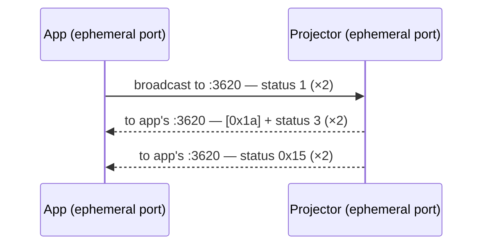

# EEMP0100 — Control Protocol

Discovery and session control for Epson wireless projectors. Control word
`EEMP0100`, port 3620 (UDP and TCP).

Implemented by: `lib/shared/header.ts` (framing), `lib/shared/constants.ts`
(captured payload templates), `lib/client/discovery.ts` + `lib/client/session.ts`
(client side), `lib/simulator/handlers.ts` (simulator side).

Everything below was checked against all five captures with
`tools/eemp_dump.py`. Claims are marked **Verified** (seen byte-for-byte,
consistently, in the captures) or **Inferred** (a reading of the bytes
that fits every sample but could be wrong). Unmarked statements are
Verified.

## Contents

- [Wire frame header](#wire-frame-header)
- [Payload layout](#payload-layout)
- [Message catalog](#message-catalog)
- [Discovery (UDP)](#discovery-udp)
- [Probe (TCP)](#probe-tcp)
- [Session establishment](#session-establishment)
- [Heartbeats](#heartbeats)
- [Session teardown](#session-teardown)
- [Reconnecting and stale sessions](#reconnecting-and-stale-sessions)
- [Session state: the user/panel model](#session-state-the-userpanel-model)
- [TLV record reference](#tlv-record-reference)
- [Identity reply (`0x03`)](#identity-reply-0x03)
- [Capabilities reply (`0x15`)](#capabilities-reply-0x15)
- [Connect request (`0x01`/fam 1)](#connect-request-0x01fam-1)
- [What `lib/` does differently from the real app](#what-lib-does-differently-from-the-real-app)

## Wire frame header

Every `EEMP0100` message, UDP or TCP, starts with this 20-byte header,
followed by `payloadLength` bytes of payload.

| Offset | Size | Field | Notes |
|---|---|---|---|
| 0 | 8 | `controlWord` | ASCII `"EEMP0100"` |
| 8 | 4 | `ipAddress` | IPv4, one byte per octet. **Always the client's IP**, in both directions, except in the projector's own `0x0a` heartbeat, which carries the projector's IP. |
| 12 | 1 | `status` | Message type, scoped by `family` |
| 13 | 1 | `family` | `0x00` or `0x01` (see below) |
| 14 | 2 | *(padding)* | Zero in all ~1,800 messages captured |
| 16 | 4 | `payloadLength` | **uint32 little-endian** |

`status` means different things in different families: status `1` is a
discovery *search* in family 0 but a *connect request* in family 1.
Family 0 holds discovery, probes, heartbeats and the `0x16` start signal.
Family 1 holds everything else in the session. *Inferred:* family 0 seems
to mean "connection-level" and family 1 "session-state-level". The split
isn't perfectly clean, since `0x16` is family 0 but only appears inside a
session.

TCP framing is implemented by `lib/shared/header.ts` `extractMessages()`:
slice complete `20 + payloadLength` messages from the stream and keep the
rest for the next read. Several messages often arrive in one TCP segment
(for example `0x02` + `0x0e` + `0x0e`).

#### Worked example, byte-for-byte

The projector's UDP identity reply to the app at `192.168.84.53`, from
`captures/Capture1.pcapng`:

```
45 45 4d 50 30 31 30 30  c0 a8 54 35  03  00  00 00  4a 00 00 00  01 00 00 00 ...
└──────── controlWord ─────────┘ └── ip ───┘ st  fam  pad  └─ len ─┘ └─ payload ─
   "EEMP0100"                 192.168.84.53  3   0    --   0x4a=74   starts here
```

`payloadLength` is `4a 00 00 00`, which is 74 read little-endian. The
74-byte payload is exactly `PJ_INFO_2` in `lib/shared/constants.ts`.

## Payload layout

Every non-empty payload starts with a fixed-size **prefix**. Some
payloads follow the prefix with a **body**: a `uint32 LE` body length and
then a list of [TLV records](#tlv-record-reference).

| Prefix kind | Size | Byte 0 | Used by |
|---|---|---|---|
| Short | 48 bytes | `0x00` | Every session message except connect request/accept; also search, probe, heartbeat |
| Long | 74 bytes | `0x01` | Identity reply `0x03`, connect request `0x01`, connect accept `0x02` |

**Byte 1 of the prefix is a "body follows" flag.** It's `0x01` in every
payload that has a body (`0x08`, `0x09`, `0x0e`, `0x17`, connect
request/accept, the 176-byte identity reply), and `0x00` in every payload
that doesn't (`0x05`, `0x07`, `0x16`, `0x27`, `0x1a`, the 74-byte identity
reply). This holds for every captured message. The capabilities reply
`0x15` is the one exception: it has its own layout (see
[below](#capabilities-reply-0x15)).

So a parser can do:

```
payload[0] == 0  → 48-byte prefix,  payload[0] == 1 → 74-byte prefix
payload[1] == 1  → body: uint32 LE length at prefix end, then TLVs
```

In the short prefix, two `uint32 LE` fields at offsets 4 and 8 carry the
small values that distinguish messages without a body (for example
`0x16` has `@8 = 1`, `0x27` has `@4 = 3`). In session-state messages,
`@4` is the [state version](#session-state-the-userpanel-model).

## Message catalog

"Payload" sizes are the full payload after the 20-byte header.
"`@n = v`" means `uint32 LE` at payload offset `n` is `v`, with everything
else zero.

| Fam | Status | Direction | Name | Payload | In `lib/`? |
|---|---|---|---|---|---|
| 0 | `0x01` | App → broadcast (UDP) | Search | 48 zero bytes | yes |
| 0 | `0x02` | App → projector (UDP unicast or TCP) | Probe | 48 zero bytes | yes |
| 0 | `0x03` | Projector → app | Identity, idle | 74 B, long prefix only | yes (`PJ_INFO_2`) |
| 0 | `0x03` | Projector → app | Identity, in use | 176 B, long prefix + body | no |
| 1 | `0x1a` | Projector → app | "In use" notice | 48 zero bytes. Sent just before the 176-byte identity. | no |
| 0 | `0x15` | Projector → app | Capabilities | 214 B, own format | yes (`PJ_INFO_3`, opaque) |
| 1 | `0x01` | App → projector | Connect request | 289 B | yes (`C_CONNECT_REQUEST`) |
| 1 | `0x02` | Projector → app | Connect accept | 240 B | yes (`PJ_CONNECT_ACCEPT`) |
| 1 | `0x0e` | Projector → app | State broadcast | 176 B or 388 B, short prefix + body, `@4` = state version | yes (`PJ_PUSH_0E_A/B`) |
| 1 | `0x08` | App → projector | Layout request | 376 B, `@4 = 0` | yes (`C_MSG_08`) |
| 1 | `0x09` | Projector → app | Layout accepted | 376 B, echoes `0x08`, `@4` = new state version | yes |
| 1 | `0x10` | Projector → app | Open video channel | empty | yes (but `lib/client` ignores it) |
| 0 | `0x16` | Projector → app | Start streaming | 48 B, `@8 = 1` | yes |
| 1 | `0x27` | App → projector | Streaming started | 48 B, `@4 = 3`. **Optional**, see below. | yes |
| 0 | `0x0a` | App → projector | Heartbeat | empty | yes |
| 0 | `0x0a` | Projector → app | Heartbeat | 48 B; `@8 = 44100` on periodic ones, `0` on the first | partly |
| 1 | `0x17` | Projector → app | Stale-session notice | 64 B: short prefix + body `{0x25: 1}` | no |
| 1 | `0x0f` | App → projector | Resume? | empty | no |
| 1 | `0x04` | App → projector | Disconnect request | empty | no |
| 1 | `0x05` | Projector → app | Disconnect ack | 48 B, `@4 = 1, @8 = 1` | no |
| 1 | `0x07` | Projector → app | Disconnected by projector | 48 B, `@4 = 1, @8 = 2` | no |

Not seen in any capture: family 0 status `0x04`, which an early version of
the simulator listened for. Status `0x0b` is the TLV tag of the same
number, not a message.

## Discovery (UDP)



- **Every UDP message is sent twice**, a few milliseconds apart, by both
  sides. This is presumably redundancy against packet loss. About half of
  all captured UDP messages are exact duplicates.
- **Both sides send from ephemeral ports. Replies always go to port 3620**
  on the app, not to the port the search came from. The app must
  therefore listen on 3620. The projector also sends its `0x03` and `0x15`
  from two *different* ephemeral ports.
- The app searches in bursts. When the projector list opens it sends about
  a dozen broadcast searches over ~3.5 s, alternating 0.2 s and 0.4 s
  apart. After that it sends occasional
  unicast UDP probes (status 2) to projectors it already knows, and more
  bursts every few seconds to tens of seconds while the list is visible.
- While a session is open on the projector, every reply gains the
  `0x1a` notice and uses the 176-byte "in use" identity (see
  [Identity reply](#identity-reply-0x03)). That's visible to *any* app on
  the network, not just the connected one.

## Probe (TCP)

The app also probes over TCP. It connects to 3620, sends status 2 (48 zero
bytes), reads `[0x1a] + 0x03 + 0x15`, and closes. During a session the app
repeats this irregularly (from ~1 s to ~30 s apart) on fresh connections. That's how it keeps
the projector's status current in its UI. It closes these probe
connections with either FIN or RST, apparently at random.

## Session establishment

Real ordering, the same in all 8 captured sessions:

```mermaid
sequenceDiagram
    participant C as App
    participant P as Projector
    C->>P: TCP connect :3620
    C->>P: 0x01/1 connect request
    P-->>C: 0x02/1 connect accept
    P-->>C: 0x0e/1 state broadcast (×2)
    C->>P: 0x0a/0 heartbeat (first one)
    P-->>C: 0x0a/0 heartbeat reply (@8 = 0)
    C->>P: 0x08/1 layout request: "put me on screen"
    P-->>C: 0x09/1 layout accepted (state version +1)
    P-->>C: 0x0e/1 state broadcast (new layout)
    P-->>C: 0x10/1 open video channel
    C->>P: TCP connect :3621 (video)
    C->>P: TCP connect :3621 (second socket; carries no data)
    P-->>C: 0x16/0 start streaming
    C->>P: 0x27/1 streaming started
    C->>P: (on :3621) EPRD hello + first frame
```

Details:

- **The app opens the video sockets when it receives `0x10`, not
  `0x16`.** In every session both TCP connections to 3621 start within
  75 ms of `0x10` (usually within 1 ms), and `0x16` arrives 39–143 ms after
  the first video connection starts. *Inferred:* the
  projector sends `0x16` once it has accepted the video connections. If
  so, a client that waits for `0x16` before connecting (as `lib/client`
  does) could stall against real hardware.
- **Two sockets to 3621.** The first one carries the EPRD video stream.
  The second carries **zero bytes in either direction** in every capture,
  yet stays open for the whole session and gets closed alongside the
  first. *Inferred:* it's an audio channel. The projector's heartbeat
  advertises 44100 Hz (see [Heartbeats](#heartbeats)), and the captured
  app had nothing to play.
- **`0x27` is optional.** On `0x16` the app sends `0x27` and starts
  writing video at the same moment. In two of the 8 sessions the first video bytes
  were on the wire *before* the `0x27`. In one session (`Capture1`, third
  session, the "resume" case) the app never sent `0x27` at all and the
  projector displayed the video anyway.
- The app's first heartbeat goes out ~100–200 ms after the connect accept,
  either just before or just after `0x08`.

## Heartbeats

These are **not request/response.** Each side runs its own ~15 s timer:

| Side | Payload | Header IP | Interval |
|---|---|---|---|
| App | empty | app's | 15.0–15.1 s steady (first gap 15.1–17.3 s) |
| Projector | 48 B, `@8 = 44100` (`0x0000ac44`) | **projector's** | 14.9–15.2 s steady (first gap 14.2–16.4 s) |

The only pairing is at the start. The projector answers the app's *first*
heartbeat immediately, with `@8 = 0`. After that the two timers drift
independently. For example, in `Capture1` the projector sent at 27.0,
42.2, 57.1, 72.1 s and the app at 28.3, 43.4, 58.4, 73.5 s.

*Inferred:* 44100 is an audio sample rate (44.1 kHz), and the projector is
re-announcing its audio settings. How long either side waits before
giving up on a silent peer isn't observable in these captures.

## Session teardown

**App disconnects** (`Capture4ClientDisconnects`):

1. App closes (FIN) both of its 3621 sockets.
2. ~300 ms later the app sends `0x04`/1, empty.
3. Projector answers `0x05`/1 (`@4 = 1, @8 = 1`).
4. Projector closes 3620 immediately after `0x05`, then both 3621 sockets
   over the next ~0.6 s. The app finishes closing 3620 (FIN then RST).
5. The projector's identity reply goes back to the 74-byte idle form
   within ~0.5 s.

**Projector disconnects** (`Capture5ProjectorDisconnects`, presumably
triggered from the projector's remote or menu):

1. Projector sends `0x07`/1 (`@4 = 1, @8 = 2`).
2. In the same millisecond, the projector FINs 3620 and both 3621 sockets.
3. App closes everything ~200–700 ms later. It doesn't reply to `0x07`.

**App just goes away** (end of `Capture1`/`Capture2` sessions): the app
FINs 3620 and both 3621 sockets at once, with no `0x04`. The projector
closes 3620 but **leaves the 3621 sockets half-open** and keeps reporting
"in use" until the next session starts, which then cleans them up. This
is what leads to the [stale-session](#reconnecting-and-stale-sessions)
behaviour.

*Inferred:* `@8` in `0x05`/`0x07` is a reason code (1 = the app asked,
2 = the projector ended it), and `@4 = 1` is a flag or count that's the
same in both.

## Reconnecting and stale sessions

When the app connects again while the projector still holds state from a
previous session by the same app (same IP and name), two things change:

- The first `0x0e` broadcasts are the 388-byte form, already showing the
  app on screen in the presenter and panel lists, instead of the 176-byte
  "nobody on screen" form.
- **The projector sends `0x17`** (body: tag `0x25` = 1) between those
  `0x0e` broadcasts. This happened in all 3 such sessions and in none of
  the 5 fresh ones. *Inferred:* "you're already registered; previous
  session restored".

In one case (`Capture1` session 3, 5 s after the app's previous
connection ended with an RST) the app also:
- set tag `0x0c` = 1 in its connect request's descriptor (normally 0),
- sent an empty **`0x0f`** right after receiving `0x17`,
- never sent `0x27`, and
- streamed a pure-black first frame instead of the "Connected to
  iProjection." splash every other session starts with.

*Inferred:* `0x0f` is a "resume" request, and the `0x0c` flag in the
connect request means "I believe I'm still connected". With only one
sample this is the weakest part of this document.

## Session state: the user/panel model

`0x08`, `0x09` and `0x0e` all carry the same thing: the projector's
**screen layout state** as nested TLV lists. Decoding all 41 captured
instances gives a consistent model. iProjection supports up to 4 devices
on screen at once (split screen) and many more connected, and the data
lines up with that:

| List tag | Meaning (*Inferred*) | Captured contents |
|---|---|---|
| `0x06` | Connected users | 1 user entry |
| `0x07` | Full-screen presenter | Before the app asks: 1 *empty slot* (id 1). After: the app's user entry. |
| `0x08` | Split-screen panels, always 4 entries | The app's user entry in panel 1, empty slots with ids 2, 3, 4 |

Each list is `uint32 count` followed by `count` entries. An entry is
either a **user** (tag `0x05` container) or an **empty slot** (tag `0x00`
container holding just tag `0x02` = slot number).

Message by message:

- **`0x0e` state broadcast** (projector → app): short prefix with
  `@0 = 0x100` (body flag set) and `@4` = **state version**, then lists
  `0x07`, `0x08`, `0x06`. The 176-byte form sent right after the accept
  has only `0x07` (empty slot 1) and `0x06` (the app).
- **`0x08` layout request** (app → projector): `@4 = 0`, then the app's
  own user entry (`0x0b` = 0, "not yet accepted"), then the layout it
  wants: list `0x07` = [itself], list `0x08` = [itself, slot 2, slot 3,
  slot 4].
- **`0x09` layout accepted**: the `0x08` echoed back with `@4` set to the
  new state version and the top-level user entry's `0x0b` changed from
  0 to 1. That's the two "patched fields" the simulator applies (payload
  offsets 4 and 120).
- **State version** (`@4`) is projector-wide and only goes up: 1, 2 in a
  projector's first session, then 3, 4, then 5, 6 in later ones. It
  doesn't reset per TCP connection. `0x09` and the following `0x0e` carry
  the same version.

User entry flags (tag `0x0b`, *Inferred*): values seen are `0` (the app's
own not-yet-accepted entry), `1` (in the connected-users list) and
`0x101`/`0x100` (in the presenter and panel lists). Bit 8 (`0x100`)
appears to mean "on screen". The meaning of bit 0 within on-screen
entries isn't clear. Both `0x101` and `0x100` occur in app-sent `0x08`s
and get echoed unchanged.

## TLV record reference

```
TAG (uint32 LE) | LENGTH (uint32 LE) | VALUE (LENGTH bytes)
```

Containers nest. Lists are `uint32 count` followed by entries.

| Tag | Len | Where | Meaning | Confidence |
|---|---|---|---|---|
| `0x00` | 12 | panel lists | Empty slot. Contains tag `0x02` = slot number (1–4). | Verified shape; meaning Inferred |
| `0x01` | var | user | Device name, **UTF-16LE** (`"VirtualBox"`) | Verified |
| `0x02` | 4 | user / slot | User: the app's IPv4 address. Slot: slot number. *Inferred:* an identifier. | Verified |
| `0x03` | 42 | in `0x04` | Projector identity: MAC (6) + IPv4 (4) + name (32, ASCII, zero-padded) | Verified |
| `0x04` | var | connect req/accept, busy identity | List (count 1) of `0x03` projector identities: the projector being talked to | Verified |
| `0x05` | 72 | everywhere | User entry: contains `0x02`, `0x0c`, `0x01`, `0x0b`, `0x1c`, in that order | Verified |
| `0x06` | var | `0x0e` | List: connected users | Inferred |
| `0x07` | var | `0x08`/`0x09`/`0x0e` | List: full-screen presenter | Inferred |
| `0x08` | var | `0x08`/`0x09`/`0x0e` | List: 4 split-screen panels | Inferred |
| `0x0b` | 4 | user | Flags, see above | Inferred |
| `0x0c` | 4 | user | `1` in every projector-sent copy and in `0x08`. `0` in the app's connect request, except in the resume case. | Values Verified, meaning Inferred |
| `0x0d` | 4 | connect req, busy identity | Always `1` | Unknown |
| `0x0f` | 4 | connect req/accept, busy identity | Always `50`. *Inferred:* maximum simultaneous connections (Epson advertises 50). | Inferred |
| `0x10` | 4 | busy identity | `1`. *Inferred:* number of connected users. | Inferred |
| `0x1c` | **0** | user | Zero-length marker that ends every user entry (earlier docs said length 4) | Verified |
| `0x1e` | 0 | connect accept | Zero-length, last record | Unknown |
| `0x25` | 4 | `0x17` | `1` | Unknown |
| `0x26` | 8 | connect req | All zero | Unknown |
| `0x2e` | 1 | connect req | `0` | Unknown |
| `0x30` | 12 | connect req | `06 00 00 00` + `"405"` + zero padding | Unknown. Possibly a length-prefixed string. |

## Identity reply (`0x03`)

Long prefix. The idle form is the prefix alone (74 B). The in-use form
adds a body (176 B).

| Offset | Size | Idle (`PJ_INFO_2`) | In use | Meaning |
|---|---|---|---|---|
| 0 | 1 | `01` | `01` | Long prefix |
| 1 | 1 | `00` | `01` | Body flag |
| 4 | 32 | `"EB005301"` | same | Projector name, ASCII, zero-padded |
| 36 | 1 | `01` | `03` | *Inferred:* status bits. Bit 1 = in use. |
| 38 | 1 | `09` | `09` | *Inferred:* model/series code (same value as capabilities record `0x01`; a second projector has `0x0c` in both places) |
| 40 | 1 | `00` | `01` | *Inferred:* number of connected users |
| 41–42 | 2 | `01 01` | `01 01` | Unknown |
| 48 | 6 | MAC | MAC | Projector MAC |
| 74 | 4 | — | `98` | Body length |
| 78 | … | — | TLVs | `0x04` (this projector's identity), `0x0d` = 1, `0x0f` = 50, `0x10` = 1 |

The in-use form is preceded by a `0x1a` message on both UDP and TCP. It's
in effect from the first reply after a connect accept (within ~0.4 s).
It switches off within ~0.5 s of a clean `0x04` disconnect. It stays on
after an app that just closes its sockets.

## Capabilities reply (`0x15`)

214 bytes. Its own format, not the prefix/TLV scheme:

| Offset | Size | Value | Meaning |
|---|---|---|---|
| 0 | 26 | MAC + zero padding | Projector ID. The second projector sample has a short ASCII name here instead. |
| 26 | 2 | `00 b8` | **uint16 big-endian length of everything from offset 30 onward** (184; 186 on the second projector) |
| 28 | 2 | `00 00` | — |
| 30 | … | records | `[type u8][len u8][len bytes]` |

Records, decoded up to offset 184 (*Verified* framing, *Inferred*
meanings):

| Type | Len | Captured value | Second projector | Meaning |
|---|---|---|---|---|
| `0x01` | 4 | `09 00 00 00` | `0c 00 00 00` | Model/series code |
| `0x02` | 6 | `"PB00"` + `00 00` | same | Protocol or model tag |
| `0x03` | 6 | 1280, 800 (u16 LE) + 0 | 1920, 1200 | Native panel resolution |
| `0x04` | 6 | 2, 1280, 800 (u16 LE) | 2, 1920, 1200 | Accepted framebuffer size. The app's EPRD hello asks for exactly this. |
| `0x05` | 88 | 4 × 22-byte entries | same shape | Encoding table, below |
| `0x07` | 10 | `01 00 01 0c 00…` | `01 00 01 0c 02 2d 00…` | Unknown |
| `0x08` | 8 | `9f 03 00 15 00 00 00 00` | `9f 06 f0 dd 00…` | Unknown (differs per unit; maybe a firmware or serial fragment) |
| `0x0a` | 10 | `00 03 01 01 32 04 01 00 00 00` | `00 2f 02 02 32 04 01…` | Unknown. Contains `0x32` = 50 (max users?). |

Each `0x05` entry starts with `07` and a sub-id (`09`, `0b`, `0d`, then
`00 00` for the fourth), followed by `uint16 LE` values:
`8, 0 | 16, 16 | 32, 32 | 656, 416 | 0, 0` for the first and
`8, 0 | 8, 8 | 16, 16 | 656, 416 | 0, 0` for the rest. *Inferred:* `07` is
RFB encoding 7 (Tight), and **656 × 416 is the maximum rectangle size**,
because the app always tiles the 1280×800 screen as 656/624 × 416/384
(see [`eprd-video-protocol.md`](./eprd-video-protocol.md)). The second
projector's entries say 480 × 1080.

The last 30 bytes (184–213) don't follow the same framing cleanly. Stray
`00` bytes appear between records that look like `0c 0d …` (containing
`ff7f ff7f`) and `0d 0a …` (containing `40 1f` = 8000). They're still
undecoded.

## Connect request (`0x01`/fam 1)

289 B: long prefix (74 B) + body (211 B). This is the only place the app
describes itself.

| Offset | Size | Value | Meaning |
|---|---|---|---|
| 0 | 2 | `01 01` | Long prefix, body follows |
| 13 | 3 | `ff ff ff` | *Inferred:* the app's netmask (255.255.255.0) is at offsets 12–15, alignment unclear |
| 20 | 4 | `00 02 0f 03` | *Inferred:* app version (3.15.2?) |
| 24 | 4 | `00 05`, `20 03` | **Screen size 1280 × 800** (u16 LE) |
| 28 | 16 | `20 20 00 01 ff00 ff00 ff00 00 08 10 000000` | **RFB pixel format**: 32 bpp, depth 32, little-endian, true colour, max 255/255/255, shifts 0/8/16 |
| 44 | 2 | `01 0c` | Unknown |
| 48 | 6 | MAC | Target projector's MAC |
| 70 | 4 | IPv4 | Target projector's IP |
| 74 | 4 | 211 | Body length |
| 78 | … | TLVs | `0x05` (the app as a user, `0x0c` = 0, `0x0b` = 0), `0x04` (target projector), `0x0f` = 50, `0x0d` = 1, `0x26`, `0x2e`, `0x30` |

The connect **accept** (240 B) uses the same layout with prefix
`@4 = 2`, the projector's MAC at 48, the IP at 70 zeroed, and body
`0x05` (app, now with `0x0c` = 1 and `0x0b` = 1), `0x04`, `0x0f` = 50,
`0x1e`.

The pixel format the app declares (32 bpp) differs from the one in its
EPRD hello (16 bpp RGB565). Since frames are JPEG anyway, neither is
actually used for pixels.

## What `lib/` does differently from the real app

| Behaviour | Real app (captures) | `lib/client` | `lib/simulator` |
|---|---|---|---|
| When to open video | On `0x10`, two sockets | On `0x16`, one socket | Accepts whatever comes |
| `0x27` | Sent with the first frame, optional | Sent before opening video | Logs it |
| Heartbeat | Every 15 s, independent | Every 3 s | Replies to each one (should run its own 15 s timer with `@8 = 44100`) |
| Video frames | Only when the screen changes | Every 500 ms | — |
| Teardown | `0x04` → `0x05`, or handles `0x07` | Just closes | Doesn't send `0x05`/`0x07` |
| Identity while busy | `0x1a` + 176-byte form | — | Always the 74-byte idle form |
| State version | Projector-wide counter | — | Hardcoded 1/2 |
| UDP replies | Sent twice, from ephemeral ports | — | Sent once, from 3620 |

None of these differences matter between `lib/client` and `lib/simulator`.
The first row is the one most likely to matter against real hardware.

### How the templates get patched

`lib/client` and `lib/simulator` send the captured payloads from
`lib/shared/constants.ts` with only the IPs swapped
(`lib/shared/header.ts` `replaceAllBytes`):

- `CAPTURE_CLIENT_IP` (`192.168.84.53`) → the live client IP.
- `CAPTURE_PROJECTOR_IP` (`192.168.84.226`) → the live projector IP
  (simulator only).

Everything else is sent verbatim from the capture: the name
`"VirtualBox"`, the MAC, `"EB005301"`, and the flags. So the simulator
always claims to be projector `EB005301` (MAC `00:00:5e:00:53:01`), and
`PJ_INFO_2`/`PJ_INFO_3` go out completely unmodified.
