# Control Channel (`EEMP0100`, TCP/UDP port 3620)

The full client-side sequence: optional discovery, a probe, then the
session that stays open for as long as you're connected to the projector.
Every message builder referenced here is in `EpsonClientMessages` in
[`EpsonProjectorKit.swift`](./EpsonProjectorKit.swift).

## Message catalog

Every `(family, status)` pair the client needs to send or recognize.
"Builder" is the `EpsonClientMessages` / `EpsonWire` function that produces
it; "constant" is the named status in `EempFamily0Status` / `EempFamily1Status`.

| Family | Status | Direction | Meaning | Builder / constant |
|---|---|---|---|---|
| 0 | 1 (`0x01`) | you → projector (UDP) | Discovery search | `EpsonClientMessages.search` |
| 0 | 2 (`0x02`) | you → projector | Probe | `EpsonClientMessages.probe` |
| 0 | 3 (`0x03`) | projector → you | Identity reply (name, MAC) | recognize via `EempFamily0Status.identity` |
| 0 | 21 (`0x15`) | projector → you | Capabilities reply | recognize via `EempFamily0Status.capabilities` |
| 1 | 1 (`0x01`) | you → projector | Connect request | `EpsonClientMessages.connectRequest` |
| 1 | 2 (`0x02`) | projector → you | Connect accept | recognize via `EempFamily1Status.connectAccept` |
| 1 | 14 (`0x0e`) | projector → you | State push (×2 after accept, ×1 after state ack) | no action needed — log and ignore |
| 1 | 8 (`0x08`) | you → projector | Client state | `EpsonClientMessages.clientState` |
| 1 | 9 (`0x09`) | projector → you | State ack | no action needed — log and ignore |
| 1 | 16 (`0x10`) | projector → you | *(unlabeled, empty)* | no action needed — log and ignore |
| 0 | 22 (`0x16`) | projector → you | **Start streaming** — open the video connection | recognize via `EempFamily0Status.startStream` |
| 1 | 39 (`0x27`) | you → projector | Stream ack | `EpsonClientMessages.streamAck` |
| 0 | 10 (`0x0a`) | you → projector | Keepalive (empty payload) | `EpsonClientMessages.keepalive` |
| 0 | 10 (`0x0a`) | projector → you | Keepalive ack (48 zero bytes) | no action needed |

Full byte-level detail and provenance for each of these is in
[`../docs/eemp-control-protocol.md`](../docs/eemp-control-protocol.md) —
this table is the subset your client actually needs to act on.

## Sequence

```mermaid
sequenceDiagram
    participant You as Your app
    participant P as Projector

    rect rgb(30, 41, 59)
    note over You,P: Probe — TCP 3620, connect then close
    You->>P: connect
    You->>P: status 2 (probe)
    P-->>You: status 3 (identity)
    P-->>You: status 21 (capabilities)
    You->>P: close
    end

    rect rgb(30, 41, 59)
    note over You,P: Session — new TCP 3620 connection, stays open
    You->>P: connect
    You->>P: status 1/family 1 (connect request)
    P-->>You: status 2/family 1 (accept)
    P-->>You: status 0x0e/family 1 ×2 (ignore)
    You->>P: status 8/family 1 (client state)
    P-->>You: status 9/family 1 (ignore)
    P-->>You: status 0x0e/family 1 (ignore)
    P-->>You: status 0x10/family 1 (ignore)
    P-->>You: status 0x16/family 0 — START STREAMING
    You->>P: status 0x27/family 1 (stream ack)
    Note over You: open TCP 3621 now — see 03-video-channel.md
    loop every ~3s, for the rest of the session
        You->>P: status 0x0a (keepalive)
        P-->>You: status 0x0a (keepalive ack)
    end
    end
```



## Step by step

### 1. Discovery (optional)

See [`README.md § Discovery is optional`](./README.md#3-discovery-is-optional--consider-skipping-it)
for why you might skip this entirely for a v1. If you do implement it:

- Broadcast `EpsonClientMessages.search(clientIP:)` over UDP to the LAN
  broadcast address (e.g. `192.168.1.255` for a `/24` — `EpsonNetworking.broadcastAddress(forIPv4:)`
  computes this from your device's own IP) on port 3620.
- **Bind your local UDP socket to port 3620 itself**, not an ephemeral
  port. The projector replies to the fixed discovery port, not to
  whatever source port your search datagram came from — a client
  listening on an ephemeral port will never see the replies. (Confirmed
  from the real capture; this is exactly the bug an early version of the
  Node reference implementation in this repo had.)
- Collect replies for a few seconds. Each responding projector sends two
  UDP datagrams back, unicast: status 3 (identity) then status 21
  (capabilities). The sender's IP address is the projector's host —
  that's the only piece of the reply you strictly need for the next step.

### 2. Probe (TCP)

Open a plain TCP connection to the projector's IP on port 3620:

```swift
connection.send(content: Data(EpsonClientMessages.probe(clientIP: myIP)), completion: .contentProcessed { _ in })
```

Wait for status 3 then status 21 back (same identity/capability pair as
discovery, just over TCP this time), then close this connection. This step
is a bit of a formality — it's what the real app is observed doing before
ever opening a session — but do it anyway to match observed real-device
behavior as closely as possible.

### 3. Session (new TCP connection)

Open a **second, new** TCP connection to the same host:port — the probe
connection must already be closed. Send the connect request:

```swift
connection.send(content: Data(EpsonClientMessages.connectRequest(clientIP: myIP)), completion: .contentProcessed { _ in })
```

`connectRequest(clientIP:)` already does the IP-patching for you — see
[`EpsonProjectorKit.swift`](./EpsonProjectorKit.swift)'s `EpsonClientMessages.patch`,
which finds every occurrence of the captured template's client IP
(`192.168.84.53`) and replaces it with the IP you pass in. You don't need
to know or care where in the 289-byte payload those occurrences are.

Then, dispatching on each incoming message's `(status, family)`:

- On **status 2 / family 1** (connect accept): send the client state
  message (`EpsonClientMessages.clientState(clientIP:)`), and **start a
  repeating ~3-second timer** that sends `EpsonClientMessages.keepalive(clientIP:)`
  for as long as the session stays open. Don't wait for anything else
  before starting the keepalive timer — it runs concurrently with the rest
  of this sequence.
- On **status 0x0e / family 1** (state push): nothing to do, just don't
  treat it as an error. You'll see it twice right after the accept, and
  once more a bit later.
- On **status 9 / family 1** (state ack) and **status 0x10 / family 1**:
  same — expected, no action.
- On **status 0x16 / family 0** ("start streaming"): send
  `EpsonClientMessages.streamAck(clientIP:)`, then open the video
  connection (port 3621) and start streaming — see
  [03-video-channel.md](./03-video-channel.md).

Keep this control connection open and the keepalive timer running for the
entire time you want to stay connected. Closing it (or letting it drop)
ends the session — session teardown isn't otherwise implemented/understood
yet, see [`../docs/README.md § Known gaps`](../docs/README.md#known-gaps).

### 4. Keepalive

Every ~3 seconds, send `EpsonClientMessages.keepalive(clientIP:)` — a
message with an **empty** payload (not the 48-zero-byte payload used by
search/probe; easy to mix up, they're different). The projector replies
with a 48-zero-byte payload on the same status/family; no action needed on
your end beyond noting the connection is still alive.

(The real iProjection app only sends one about every **15 seconds**, per
the captures. 3 s matches `lib/client` and works with the simulator. See
[`../docs/reverse-engineering-todo.md`](../docs/reverse-engineering-todo.md)
for what's still unconfirmed, including teardown messages this guide
doesn't cover yet.)

## Complete worked example

```swift
import Network

final class ProjectorSession {
    private var connection: NWConnection?
    private var pending: [UInt8] = []
    private var keepaliveTimer: Timer?
    private let clientIP: [UInt8]
    private let host: String
    private var onStartStreaming: (() -> Void)?

    init(host: String, clientIP: [UInt8]) {
        self.host = host
        self.clientIP = clientIP
    }

    func connect(onStartStreaming: @escaping () -> Void) {
        self.onStartStreaming = onStartStreaming
        let conn = NWConnection(host: NWEndpoint.Host(host), port: 3620, using: .tcp)
        connection = conn
        conn.stateUpdateHandler = { [weak self] state in
            if case .ready = state { self?.sendConnectRequest() }
        }
        conn.start(queue: .main)
        receiveLoop()
    }

    private func send(_ bytes: [UInt8]) {
        connection?.send(content: Data(bytes), completion: .contentProcessed { _ in })
    }

    private func sendConnectRequest() {
        send(EpsonClientMessages.connectRequest(clientIP: clientIP))
    }

    private func receiveLoop() {
        connection?.receive(minimumIncompleteLength: 1, maximumLength: 65536) { [weak self] data, _, isComplete, error in
            guard let self else { return }
            if let data { self.pending.append(contentsOf: data) }
            let (messages, rest) = EpsonWire.extractMessages(self.pending)
            self.pending = rest
            for message in messages { self.handle(message) }
            if error == nil && !isComplete { self.receiveLoop() }
        }
    }

    private func handle(_ message: [UInt8]) {
        guard let header = EpsonWire.decodeHeader(message) else { return }

        switch (header.family, header.status) {
        case (1, EempFamily1Status.connectAccept):
            send(EpsonClientMessages.clientState(clientIP: clientIP))
            startKeepalive()
        case (0, EempFamily0Status.startStream):
            send(EpsonClientMessages.streamAck(clientIP: clientIP))
            onStartStreaming?()
        default:
            break // 0x0e pushes, 0x09 ack, 0x10, keepalive acks — nothing to do
        }
    }

    private func startKeepalive() {
        keepaliveTimer?.invalidate()
        keepaliveTimer = Timer.scheduledTimer(withTimeInterval: 3.0, repeats: true) { [weak self] _ in
            guard let self else { return }
            self.send(EpsonClientMessages.keepalive(clientIP: self.clientIP))
        }
    }

    func disconnect() {
        keepaliveTimer?.invalidate()
        connection?.cancel()
    }
}
```

This mirrors `connectToProjector()` in [`../lib/client/session.ts`](../lib/client/session.ts)
almost line for line — useful to cross-reference if anything here is
unclear, since that version has already been run against real projector
captures during this repo's original reverse-engineering work.
